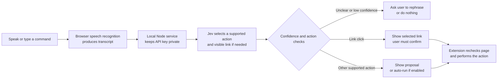

# Jev Voice Browser Controller

A voice-controlled browser extension for Chrome and Edge. Speak a command such as “open example.com” or “click the pricing link”. Browser speech recognition transcribes the command, Jev classifies it, and the extension offers a bounded browser action for you to review.

> **Important:** Use the installed extension popup in standalone Chrome or Edge to control a browser tab. The page at `http://localhost:5173` is only a UI preview; it cannot access your active browser tab. Keep the local server running while you use the unpacked extension.

## How It Works



Speech recognition and Jev are separate: the browser transcribes audio; Jev only evaluates the resulting text and returns a structured decision. The extension performs the browser action after its checks.

## Requirements

- Node.js 20 or newer and npm
- Chrome or Edge desktop
- A TypeSafe API key from the [TypeSafe console](https://console.typesafe.ai/keys)
- A microphone and browser microphone permission for voice use; speech recognition availability depends on browser, operating system, language, and network

## First-Time Setup

Run these commands from the project folder:

```sh
npm install
cp .env.example .env
```

Open `.env` in an editor and replace the example value with your TypeSafe API key:

```dotenv
TYPESAFE_API_KEY=your-real-key-here
TYPESAFE_MODEL=jev-latest
PORT=8787
```

Do not commit `.env`, paste the key into the browser, or put it in a `VITE_*` variable. The key belongs only to the local Node service. Restart `npm run dev` after changing `.env`.

## Start The App

1. Start the UI preview and local Jev service:

   ```sh
   npm run dev
   ```

2. Leave that terminal running. It starts:
   - UI preview at [http://localhost:5173](http://localhost:5173)
   - Local Jev service at `http://127.0.0.1:8787`

   The preview is useful for seeing the interface, but browser control only works from the installed extension popup.

3. In a second terminal, build the extension:

   ```sh
   npm run build
   ```

4. Open the extensions page in your browser:
   - Chrome: [chrome://extensions](chrome://extensions)
   - Edge: [edge://extensions](edge://extensions)

5. Turn on **Developer mode**, choose **Load unpacked**, and select the project's **`dist` folder**. Select `dist/`, not the project root and not `src/`.

   On Linux, the folder is typically:

   ```text
   /home/kundan/Jev-Project/VoiceControlledWebApp/dist
   ```

   On Windows or macOS, select the same project's `dist` folder wherever you cloned it.

6. Confirm that **Jev Voice Browser Controller** appears in the extension list and is enabled. Pin it from the puzzle-piece Extensions menu if you want its icon beside the address bar.

## Use Voice Control

1. In the same Chrome/Edge window, open a regular `http://` or `https://` website. Browser-internal pages such as `chrome://extensions` cannot be controlled.
2. Click the Jev extension icon to open its popup.
3. On the active-page row, click **Connect site**. Approve the browser prompt. This grants access to that site only; repeat on another site if needed.
4. If the browser asks for microphone permission, choose **Allow**. Speech recognition starts only after you click **Tap to speak**.
5. Speak a short command. When recognition finishes, the transcript is sent to the local service and Jev proposes an action.
6. Review the action and confidence, then click **Run action** or **Review & click link**. Link clicks always require confirmation.

You can also type a command into the transcript box and click **Understand**. This is useful when speech recognition is unavailable or the transcript needs correction.

### Example Commands

- “Open example.com”
- “Go to https://example.com/pricing”
- “Search the web for weather in Toronto”
- “Click the pricing link”
- “Go back” or “go forward”
- “Scroll down” or “scroll up”

The extension can only click a visible, ordinary HTTP(S) link present on the connected page. It does not click buttons or submit forms. When a website is spoken without a clear address, the app searches rather than making up a URL.

### Optional Automatic Actions

The **Auto-run simple actions** switch is off by default. When turned on, navigation, search, history, and scroll actions may run automatically when Jev confidence is at least 86%. Link clicks are never automatic. Low-confidence and unsupported commands are not run.

## Speech Recognition Notes

- The app prefers on-device speech recognition when Chromium supports it and the selected language pack is installed.
- On first use, if Chromium reports the selected offline language pack as downloadable, the app starts installing it and shows a status message. Wait for installation to finish, then click **Tap to speak** again.
- If a pack is not available, the browser may use its speech service, which can require a working network connection and may process audio through the browser vendor. Jev receives the transcript, not audio.
- The VS Code embedded browser/preview may not have a usable speech service or local language pack. If you see a speech `network` error there, use the extension popup in standalone Chrome or Edge. You can always type a command instead.
- Browser microphone permissions and operating-system microphone privacy settings must both allow access.

## Permissions, Data, And Safety

- The extension requests access only to the current HTTP(S) site's origin after you click **Connect site**. It does not request all-site access on install. You can revoke site permissions in browser extension settings.
- It reads the current page title/address and up to 100 visible link labels and URLs. It does not collect the page body, cookies, or form contents.
- For a command, the local service sends the transcript and this limited page context to TypeSafe/Jev. The API key stays on the local server.
- Every proposed action is checked against the active page. The extension rejects stale proposals if the active page changed.
- Link clicks are confirmed by the user and rechecked against the current visible link. There is no arbitrary JavaScript execution, form submission, purchase, or button activation.
- Voice input uses the browser's SpeechRecognition implementation and its privacy/data behavior depends on browser settings and whether processing is local or remote. Review the browser vendor's speech privacy terms for your environment.
- This is a prototype. Do not use it for high-risk or irreversible workflows without additional security review and user confirmation.

## Troubleshooting

**“Set `TYPESAFE_API_KEY` in the local server environment.”**

Add your key to `.env` in the project root, then stop and restart `npm run dev`. The extension does not contain the key.

**“The browser speech service could not connect” / speech error `network`.**

This is the browser's speech recognizer failing to connect; it is not a Jev API error. Open the extension from the toolbar in standalone Chrome/Edge rather than using the `localhost:5173` preview. Check network/proxy access and microphone settings, or type the command into the transcript field. If a local language pack is offered, install it and tap to speak again.

**“Load the unpacked extension” or “No active tab”.**

Use the extension popup from Chrome/Edge's toolbar. The localhost preview cannot control tabs. Ensure the extension is enabled and a regular website tab is active.

**No “Connect site” button or the browser says access is unavailable.**

Use a normal HTTP(S) website. Browser-internal pages, extension stores, and some restricted pages do not allow extension scripting.

**The extension does not show my latest changes.**

Run `npm run build`, open the browser's extensions page, and click **Reload** on Jev Voice Browser Controller. Keep `npm run dev` running for the local API service.

## Development Checks

```sh
npm run typecheck
npm run build
```

Useful project files:

- `src/App.tsx`: popup UI, speech recognition, proposal review, and controls
- `src/extension/background.ts`: extension permissions, active-tab checks, and browser actions
- `src/extension/content.ts`: visible-link collection, link recheck/click, and page scrolling
- `server/index.ts`: validated, server-side Jev requests
- `public/manifest.json`: extension permissions and entry points
- `TYPESAFE.md`: TypeSafe API/model reference for this project

For API/schema and model details, see [TYPESAFE.md](./TYPESAFE.md) and the official [TypeSafe API documentation](https://docs.typesafe.ai/api).